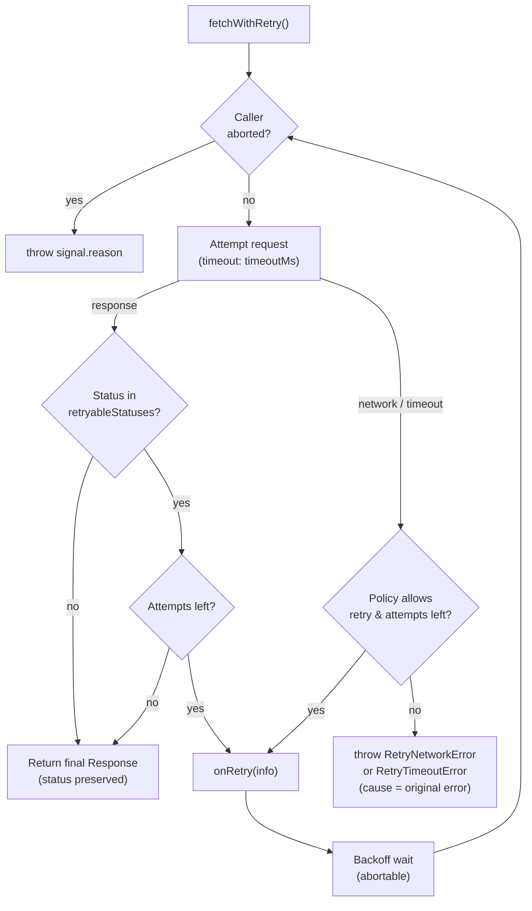

<div align="center">

<!-- banner:start -->


**A tiny, type-safe retry & timeout layer for the native Fetch API**

[](#installation)
[](#compatibility)
[](#license)
[](#installation)
[](#installation)

`exponential backoff` · `jitter` · `Retry-After` · `per-attempt timeouts` · `cancellation` · `ESM + CJS`

</div>

---

## 🎯 What it does

`fetchWithRetry` wraps `globalThis.fetch` and adds **policy-driven retries** for transient failures:

| ✅ Retries by default | ❌ Never retried by default |
| --- | --- |
| HTTP `429`, `500`, `502`, `503`, `504` (configurable) | Client errors: `400`, `401`, `403`, `404`, … |
| Network failures (DNS, connection reset, …) | Caller cancellation (`AbortSignal`) |
| Per-attempt timeouts | `POST` / `PATCH` (unless you opt in) |
| `Retry-After` on `429` / `503` | Bodies that cannot be replayed (streams) |

**What it does _not_ do:** parse bodies, queue or rate-limit requests, add circuit breakers, retry on _every_ 5xx unless configured to, or hide the final HTTP status — the last response is always returned to you as-is.

---

## ✨ Features

- 🪶 **Zero dependencies** — native `fetch` + `AbortController` only
- 📦 **Dual ESM & CommonJS** builds, fully typed, tree-shakeable (`sideEffects: false`)
- 🎲 **Exponential backoff + jitter** — documented bounds, no thundering herds
- 📡 **`Retry-After` awareness** — seconds *and* HTTP-date formats, safely clamped
- ⏱️ **Per-attempt timeouts** — timers never leak into backoff or after completion
- 🧾 **Body-safe retries** — streams are never blindly re-sent; non-idempotent verbs need explicit opt-in
- 🧪 **Deterministic test suite** — mocked `fetch`, no network, real assertions

---

## 📦 Installation

```bash
npm install @codessy/fetch-shield
```

Requires Node.js **≥ 18** (native fetch) or any modern browser with `fetch` + `AbortController`.

---

## 🚀 Quick start

```ts
import { fetchWithRetry } from "@codessy/fetch-shield";

const response = await fetchWithRetry(
  "https://api.example.com/users",
  { method: "GET" },
  {
    maxAttempts: 4,
    baseDelayMs: 300,
    maxDelayMs: 5000,
    timeoutMs: 8000,
  },
);

if (!response.ok) {
  throw new Error(`HTTP error: ${response.status}`);
}

const users = await response.json();
```

> 💡 Transient `503`s are retried **inside** the call. When attempts run out you still get the
> final `Response` — inspect `response.status` yourself. Only network/timeout failures **throw**.

---

## ⚙️ Configuration

`fetchWithRetry(input, init?, options?)`

- `input` — `string | URL | Request`
- `init` — standard `RequestInit` (including `signal` for cancellation)
- `options` — `FetchRetryOptions` (table below)

| Option | Type | Default | Description |
| --- | --- | --- | --- |
| `maxAttempts` | `number` | `3` | Total attempts, **including** the first. Use `1` to disable retries. |
| `baseDelayMs` | `number` | `300` | First backoff delay; doubles each retry. |
| `maxDelayMs` | `number` | `5000` | Upper bound for backoff **and** `Retry-After` values. |
| `timeoutMs` | `number` | `10000` | **Per-attempt** timeout in ms. `0` disables the timer. |
| `retryableStatuses` | `readonly number[]` | `[429, 500, 502, 503, 504]` | Statuses that trigger a retry. |
| `retryOnNetworkError` | `boolean` | `true` | Retry fetch rejections (DNS, resets, …). |
| `retryOnTimeout` | `boolean` | `true` | Retry attempts killed by `timeoutMs`. |
| `retryNonIdempotent` | `boolean` | `false` | Allow retries for `POST`/`PATCH`/… |
| `onRetry` | `(info: RetryAttemptInfo) => void` | — | Called before each backoff wait. |

Invalid values (wrong type, negative numbers, out-of-range statuses, unknown keys…) throw
`InvalidRetryOptionsError` **before any request is sent**:

```ts
import { fetchWithRetry, InvalidRetryOptionsError } from "@codessy/fetch-shield";

try {
  await fetchWithRetry(url, undefined, { maxAttempts: 0 });
} catch (error) {
  // InvalidRetryOptionsError:
  // Invalid fetch-shield options: "maxAttempts" must be an integer >= 1, received 0
  if (error instanceof InvalidRetryOptionsError) throw error;
}
```

<details>
<summary><b>Full option type definitions</b></summary>

```ts
type FetchInput = string | URL | Request;

type RetryReason =
  | { type: "http-status"; status: number; retryAfterMs: number | null }
  | { type: "network-error"; error: unknown }
  | { type: "timeout"; timeoutMs: number };

interface RetryAttemptInfo {
  attempt: number;    // 1-based attempt that just failed
  maxAttempts: number;
  delayMs: number;    // computed wait before the next attempt
  reason: RetryReason;
}

interface FetchRetryOptions {
  maxAttempts?: number;
  baseDelayMs?: number;
  maxDelayMs?: number;
  timeoutMs?: number;
  retryableStatuses?: readonly number[];
  retryOnNetworkError?: boolean;
  retryOnTimeout?: boolean;
  retryNonIdempotent?: boolean;
  onRetry?: (info: RetryAttemptInfo) => void;
}
```

</details>

---

## 🔁 How retries work



Default policy in plain words:

1. Attempt the request (unless the caller signal is already aborted).
2. `2xx`/`3xx`/non-retryable `4xx` → **return immediately**.
3. Retryable status with attempts remaining → wait, then retry.
4. Network error or timeout with attempts remaining → wait, then retry.
5. Attempts exhausted → **return the last response** (HTTP) or **throw** a typed error with `cause` (network/timeout).

---

## 📈 Backoff & jitter

Delays follow capped exponential backoff with **equal jitter**:

```text
capped  = min(maxDelayMs, baseDelayMs × 2^(attempt − 1))
delay   = capped × random(0.5 … 1.0)          // uniform jitter
```

The final delay is always in **[50%, 100%]** of the capped value, so clients spread out instead of
striking the server in lock-step. With `baseDelayMs: 300`, `maxDelayMs: 5000`:

| After failed attempt | Capped delay | Actual delay (jitter) |
| --- | --- | --- |
| 1 | 300 ms | 150 – 300 ms |
| 2 | 600 ms | 300 – 600 ms |
| 3 | 1200 ms | 600 – 1200 ms |
| 4 | 2400 ms | 1200 – 2400 ms |
| 5 | 4800 ms | 2400 – 4800 ms |
| 6+ | 5000 ms (cap) | 2500 – 5000 ms |

The pure function is exported for testing and tuning: `computeBackoffDelay(attempt, { baseDelayMs, maxDelayMs, random? })`.

---

## ⏱️ Timeout & cancellation semantics

- `timeoutMs` applies **per attempt**, not to the whole operation. Backoff waits are *not* covered by it.
- Each attempt runs under an internal `AbortController`; your signal is **linked**, so both
  cancellation sources work and neither is lost:

```ts
const controller = new AbortController();
setTimeout(() => controller.abort(new Error("user navigated away")), 5_000);

await fetchWithRetry(url, { signal: controller.signal }, { timeoutMs: 8000 });
// → rejects with YOUR error when you abort (during an attempt or mid-backoff)
```

- A timeout **aborts the in-flight attempt** via `AbortController` and is then retried (if
  `retryOnTimeout` and attempts allow). It never silently waits past your limit.
- Timers and `abort` listeners are cleaned up on success, failure, and cancellation.
- ⚠️ Cancellation applies **until the response is returned**. After that, aborting the signal does
  not cancel body streaming — use `response.body?.cancel()` or your own signal for that.

---

## 📅 Retry-After handling

For **`429` and `503`** responses only, a valid `Retry-After` header replaces backoff:

- `Retry-After: 120` → wait 120 s
- `Retry-After: Fri, 31 Dec 2026 23:59:59 GMT` → wait until that HTTP-date (past dates → 0 ms)
- **Clamped** to `maxDelayMs` — if the server asks for 10 minutes but `maxDelayMs` is 5 s, we wait
  5 s and retry anyway (raise `maxDelayMs` to honor longer server waits; the server may keep
  throttling you regardless)
- Invalid / unparsable values fall back to normal backoff + jitter
- Other statuses (e.g. `500`) ignore the header

```ts
const start = Date.now();
await fetchWithRetry(url, init, { baseDelayMs: 30_000 }); // 429 + "Retry-After: 0"
console.log(Date.now() - start); // ≈ 0 — header won over the 30 s backoff floor
```

`parseRetryAfter(value, nowMs?)` is exported if you need the same logic elsewhere.

---

## 🧾 Request-body safety & idempotency

> ### ⚠️ Retrying `POST` can duplicate server-side effects
> If the server already processed attempt #1 and we retry, you may charge a card twice or create
> two records. That is why **non-idempotent methods are never retried by default**.

| Request shape | Default behavior |
| --- | --- |
| `GET`/`HEAD`/`OPTIONS`/`TRACE`/`PUT`/`DELETE`, replayable body | Retried ✅ |
| `POST`/`PATCH` (or any other method) | **Single attempt** unless `retryNonIdempotent: true` |
| Body is a `ReadableStream` (or Node stream) | **Single attempt** — streams are consumed once |
| Input is a `Request` carrying a body | **Single attempt** — its body stream is consumed once |
| Body is `string`, `Blob`, `FormData`, `ArrayBuffer`, `URLSearchParams`, … | Safe to replay ✅ |

We never send a “broken retry”: if the body can't be recreated, the first response/error is
returned or thrown as-is instead of re-sending a consumed stream.

**Opting in for POST** (only if your API supports it):

```ts
await fetchWithRetry(
  "https://api.example.com/orders",
  {
    method: "POST",
    headers: {
      "content-type": "application/json",
      // Best practice: make the server deduplicate
      "idempotency-key": crypto.randomUUID(),
    },
    body: JSON.stringify({ sku: "A-1", qty: 2 }),
  },
  { retryNonIdempotent: true },
);
```

Use an **Idempotency-Key** header (Stripe-style) whenever your API supports it — then even a
network-blip retry is safe because the server collapses duplicates.

---

## ❌ Error handling

| Error | When | Useful fields |
| --- | --- | --- |
| `InvalidRetryOptionsError` | Bad `options` — thrown **before** any request | message lists every bad field |
| `RetryNetworkError` | Fetch rejected and no retries remain | `attempts`, `cause` = original error |
| `RetryTimeoutError` | Last attempt(s) hit `timeoutMs` | `attempts`, `timeoutMs`, `cause` |
| `signal.reason` (yours) | You aborted — never wrapped | whatever you passed to `abort()` |

HTTP statuses are **never** thrown — the final `Response` is returned so nothing is hidden:

```ts
import {
  fetchWithRetry,
  RetryNetworkError,
  RetryTimeoutError,
} from "@codessy/fetch-shield";

try {
  const res = await fetchWithRetry(url, { signal }, { maxAttempts: 4 });

  if (!res.ok) {
    console.warn(`Gave up with HTTP ${res.status}`); // e.g. 503 after 4 attempts
  }
  return res;
} catch (error) {
  if (error instanceof RetryTimeoutError) {
    console.error(`Timed out after ${error.attempts} attempts (${error.timeoutMs}ms each)`);
    console.debug("last underlying error:", error.cause);
  } else if (error instanceof RetryNetworkError) {
    console.error(`Network failure after ${error.attempts} attempts`, error.cause);
  } else {
    throw error; // caller abort or unrelated bug — don't swallow
  }
}
```

Observability hook — log or emit metrics for every retry:

```ts
await fetchWithRetry(url, init, {
  onRetry: ({ attempt, maxAttempts, delayMs, reason }) => {
    metrics.increment("http.retry", { type: reason.type });
    logger.warn(`retry ${attempt}/${maxAttempts} in ${delayMs}ms`, reason);
  },
});
```

---

## 🌐 ESM & CommonJS

Both entry points are built, type-checked, and covered by the test suite.

```ts
// ESM / TypeScript
import { fetchWithRetry } from "@codessy/fetch-shield";
```

```js
// CommonJS
const { fetchWithRetry } = require("@codessy/fetch-shield");
```

```ts
// Also exported (advanced/testing utilities)
import {
  computeBackoffDelay,
  parseRetryAfter,
  isRetryAfterStatus,
  DEFAULT_RETRY_OPTIONS,
  DEFAULT_RETRYABLE_STATUSES,
  JITTER_FLOOR_RATIO, // 0.5 → jitter spans [50%, 100%] of capped delay
} from "@codessy/fetch-shield";
```

---

## 🧭 Compatibility

| Environment | Status |
| --- | --- |
| Node.js ≥ 18 (native `fetch`) | ✅ Primary target — `engines: ">=18"` |
| Node.js 22 / 24 | ✅ Run by CI and the local suite |
| Modern browsers (Chrome/Edge/Firefox/Safari, evergreen) | 🧩 Uses only standard `fetch`, `AbortController`, `setTimeout` — expected to work, **not** covered by automated browser tests |
| Node.js < 18 | ❌ No global `fetch` — not supported |

Only platform APIs (`fetch`, `AbortController`, `AbortSignal`, `Headers`, `DOMException`) are used —
no Node-specific modules in `src/`.

> Developing this repo requires Node.js with built-in TypeScript type stripping enabled
> (Node.js **≥ 23.6**, or recent **22.x** where it was backported). The *published library* runs on **≥ 18**.

---

## 🧪 Development

```bash
npm install          # dev deps: typescript, @types/node, biome
npm run build        # ESM + CJS + .d.ts → dist/
npm test             # builds, then runs node:test on test/**/*.test.ts
npm run typecheck    # strict tsc --noEmit (src + tests + examples)
npm run lint         # biome check
npm run validate     # typecheck + lint + test   (also runs via prepublishOnly)
npm pack --dry-run   # inspect exactly what would be published
```

Tests never touch the network — `fetch` is mocked per test. After `npm run build` you can run the
examples (they call real hosts):

```bash
node examples/basic.ts
node examples/custom-retry.ts
```

---

## 🏢 Integrating into an API service

```ts
// src/http-client.ts — one hardened client for the whole service
import { fetchWithRetry, RetryNetworkError, RetryTimeoutError } from "@codessy/fetch-shield";

const API_BASE = process.env.API_BASE_URL ?? "http://localhost:3000";

export async function apiFetch<T>(path: string, init?: RequestInit): Promise<T> {
  const response = await fetchWithRetry(
    `${API_BASE}${path}`,
    {
      ...init,
      headers: { accept: "application/json", ...init?.headers },
      signal: init?.signal ?? AbortSignal.timeout(15_000),
    },
    {
      maxAttempts: 3,
      baseDelayMs: 250,
      maxDelayMs: 4000,
      timeoutMs: 5000,
      retryableStatuses: [429, 500, 502, 503, 504],
      onRetry: ({ attempt, reason }) => console.warn(`[http] retry ${attempt}`, reason),
    },
  );

  if (!response.ok) {
    throw new Error(`API ${path} failed: HTTP ${response.status}`, { cause: response });
  }
  return (await response.json()) as T;
}

// usage
try {
  const user = await apiFetch<{ id: string }>("/users/42");
} catch (error) {
  if (error instanceof RetryTimeoutError) { /* degrade gracefully */ }
  if (error instanceof RetryNetworkError) { /* fall back to cache */ }
  throw error;
}
```

---

## 🤝 Contributing

1. Fork & branch (`git checkout -b feature/my-change`)
2. Keep the public API small — open an issue before large additions
3. `npm run validate` must pass (typecheck + lint + full test suite)
4. Add regression tests for any bug you fix
5. Open a PR — CI runs the same `validate` on Node 22 & 24

---

## 📄 Releasing (maintainers)

```bash
npm run validate        # full gate — also wired to prepublishOnly
npm pack --dry-run      # verify file list (dist/, README.md, LICENSE)
npm publish             # you publish manually; nothing auto-publishes
```

---

## 📄 License

[MIT](./LICENSE) © Codessy

<div align="center">
  <sub>Built for the Fetch API · No dependencies · No magic · No surprise retries on <code>POST</code> 🤝</sub>
</div>
# fetch-shield
